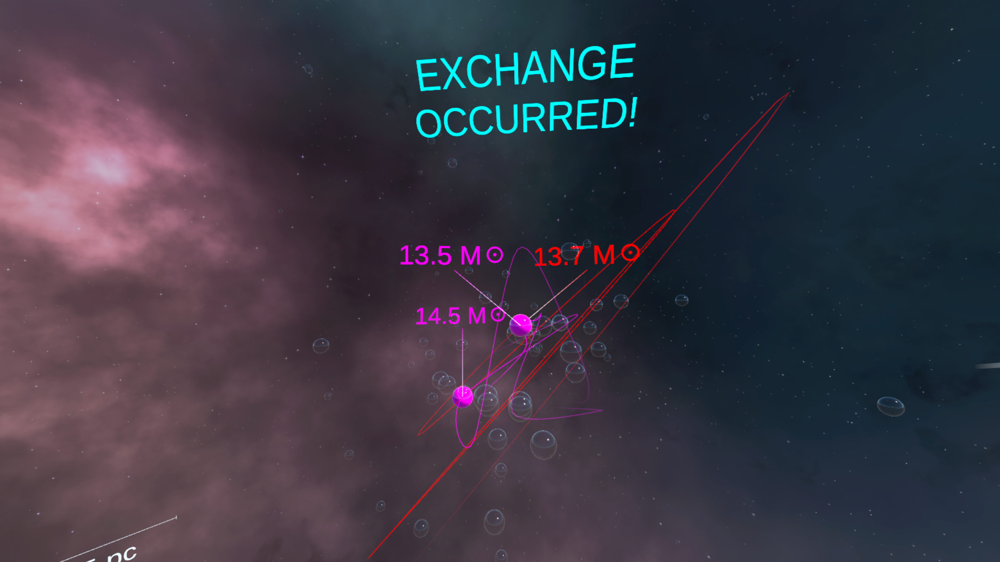
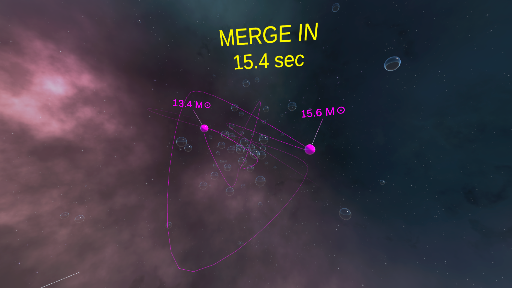
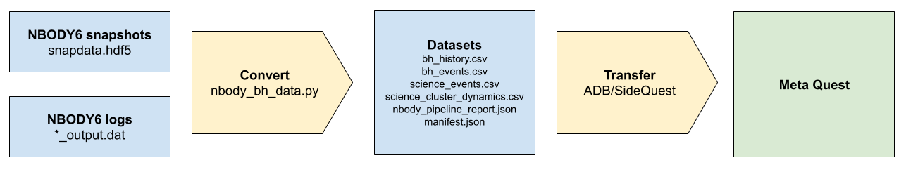

# NBody-VR Visualizer

<p align="center">
  
</p>

NBody-VR Visualizer is a standalone Meta Quest application for exploring black-hole dynamics from NBODY6 simulations in an interactive 3D environment. It shows black-hole positions, trajectories, masses, velocities, binaries, exchange interactions, and mergers along a simulation timeline. NBODY6 and its regularization methods are described by [Aarseth (1999)](https://doi.org/10.1086/316455).

The APK includes a sample dataset, so the application can be tried without running Python or transferring simulation files. To visualize your own NBODY6 run, convert its HDF5 snapshots and output logs with the included `nbody_bh_data.py` script.

## What you can see

- Animate black-hole motion across stored HDF5 snapshots.
- Jump to `EXCHANGE`, `TRANSIENT EXCHANGE`, and `MERGE` records parsed from NBODY6 logs.
- Inspect an event with colored bodies, mass labels, and past/future trajectory segments.
- Switch between raw simulation coordinates and the cluster centre-of-mass frame.
- Follow an individual black hole or the centre of mass of a selected binary.
- Open Science Mode for log values, snapshot measurements, derived quantities, model comparisons, and later escape-log matches.

### Exchange event

<table width="100%">
  <thead>
    <tr>
      <th width="50%">Before</th>
      <th width="50%">After</th>
    </tr>
  </thead>
  <tbody>
    <tr>
      <td width="50%" align="center"></td>
      <td width="50%" align="center"></td>
    </tr>
    <tr>
      <td width="50%">The original binary members are magenta and the incoming 'interloper' is red.</td>
      <td width="50%">The post-event state is shown after the recorded exchange.</td>
    </tr>
  </tbody>
</table>

### Merge event

<table width="100%">
  <thead>
    <tr>
      <th width="50%">Before</th>
      <th width="50%">After</th>
    </tr>
  </thead>
  <tbody>
    <tr>
      <td width="50%" align="center"></td>
      <td width="50%" align="center"></td>
    </tr>
    <tr>
      <td width="50%">The two pre-merge binary members are highlighted in magenta.</td>
      <td width="50%">The merged remnant is highlighted in cyan.</td>
    </tr>
  </tbody>
</table>

The spheres, labels, and trajectory lines are display aids. Sphere diameter is proportional to the mass stored in the visualization data multiplied by the current **Size** setting; it is not a black-hole horizon scale. See [Appendix: Science Mode](#appendix-science-mode) for the precise meaning and limitations of the event display.

## Quick Play with the bundled sample

Quick Play uses the dataset packaged in `Assets/StreamingAssets/NBODYVR_Data/`. No Python conversion or manual data transfer is required.

### Requirements

- A Meta Quest headset set up for sideloading
- A USB cable
- [SideQuest](https://sidequestvr.com/) or Android Debug Bridge (`adb`)
- An APK from [GitHub Releases](https://github.com/gkawa08/nbody-vr-visualizer-unity/releases)

### Install and launch

1. Download the APK from GitHub Releases.
2. Install it with SideQuest, or use `adb`:

   ```bash
   adb install /path/to/NBodyVis.apk
   ```

3. On the headset, open the application from the section used for sideloaded or unknown-source applications.
4. NBody-VR opens its two-page tutorial. Select **EN** or **JP**, read the overview, and choose **Start Exploring**.

If no external dataset is present, the application automatically loads the bundled sample.

### Control panel

<p align="center">
  
</p>

<p align="center"><em>The main panel controls event selection, playback, reference frame, display size, Science Mode, and Follow Mode.</em></p>

Point the controller ray at a UI element and press the trigger to operate it.

### A short first session

1. Press **Play** and watch the black holes move through the stored snapshots.
2. Drag the timeline or use **&lt;** and **&gt;** to inspect individual frames.
3. Open **Select Event...** and select an exchange or merger.
4. Watch the event countdown and the highlighted trajectories.
5. Turn **Science** on to show the detailed event panel.
6. Open **Follow Mode** and select a black hole or, when available, a pre- or post-event binary centre of mass.
7. Press **Reset Camera** to return the XR rig and control panel to their initial positions.

### Main controls

| Control | What it does |
|---|---|
| **Help** | Reopens the English/Japanese tutorial. |
| **Science: ON/OFF** | Shows or hides Science Mode. The detailed panel appears when an event is selected and compatible science data are loaded. |
| **Follow Mode** | Opens a target list. Select an available black hole or a selected event's binary centre of mass. Press **Exit Follow** to leave the mode. |
| **Select Event...** | Lists exchange, transient-exchange, and merger events whose participants can be represented from the loaded history. |
| **Timeline** | Selects a stored simulation frame directly. |
| **&lt; / &gt;** | Moves backward or forward by one stored frame. |
| **Speed** | Changes playback from the configured minimum to maximum steps per second on a logarithmic scale. The middle position uses the configured initial speed. |
| **Size** | Changes only the visual scale of the black-hole spheres. |
| **Pos: CoM / Pos: Raw** | Switches between cluster centre-of-mass-relative positions and raw simulation coordinates. This button is disabled while Follow Mode is active. |
| **Reset Camera** | Restores the XR rig and the main panel to their initial poses. |
| **Play / Stop** | Starts or stops playback. Playback loops to the first stored frame after the last frame. |

Selecting an event moves playback to a short pre-event lead-in. In the bundled scene it can also move the player closer to the event, move the panel by the same translation, and reduce the black-hole display size on the first event selection. These behaviours are configurable in the `CsvVisualizer` Inspector.

### Controller and panel actions

- The controller ray and trigger operate the UI.
- The controller **Primary Button** toggles the main UI. The bundled scene labels this action as **A**.
- When the main UI is closed, the right thumbstick's vertical axis moves the XR rig vertically.
- The main panel has an XR grab interaction. While it is held, it turns to face the player and remains upright; it faces the player again when released.
- When an event is selected while the panel is hidden, a world-space event countdown or completion message remains visible.

### Colors and event graphics

The current defaults in `CsvVisualizer` are:

| Display | Default color or behaviour |
|---|---|
| Black hole with no selected event role | Black |
| Selected binary member | Magenta |
| Incoming/interloping black hole | Red |
| Post-merge remnant | Cyan |
| Transient-exchange participant | Orange |
| Other objects during a selected event | Dimmed |
| Trajectory | Smoothed line using configurable past and future frame windows |
| Scale bar | Camera-facing world-space bar; its label and length are configurable |

## Use your own NBODY6 data

The converter reads one NBODY6 run and builds a self-contained NBody-VR dataset folder.

<p align="center">
  
</p>

### 1. Prepare the input directory

Place these files from the same simulation in one directory:

- `snapdata.hdf5` or `snapsdata.hdf5`
- one or more corresponding log files named `*_output.dat`

The converter validates that the HDF5 file contains `snap_*` groups. Each selected snapshot must provide `id`, `m`, `kw`, `x`, `y`, `z`, `vx`, `vy`, `vz`, and a scalar `t`. If a valid `N` value is present, rows `0:N` are treated as physical particles; otherwise the array length is used.

By default, the converter selects `kw == 14` as black holes. Use `--bh-type` only if the stellar-type convention in your data is different.

### 2. Prepare Python

The converter requires Python 3, NumPy, and h5py:

```bash
python -m pip install numpy h5py
```

If either module is missing, the script offers to install it before conversion. `adb` is optional and is needed only for the script's direct-to-Quest transfer step.

### 3. Run the guided conversion

The simplest route is the interactive mode:

```bash
python nbody_bh_data.py
```

The script asks for:

1. the NBODY input directory;
2. a dataset-folder name; and
3. whether to validate only or build the dataset.

After a successful build it asks whether to transfer the dataset folder to the connected Quest. The default answer is **yes**. If the destination already exists locally or on the headset, the script asks before retaining the old folder as a timestamped backup and replacing it.

Input files are read but never modified.

### 4. Run a non-interactive conversion

To create a local dataset without transferring it:

```bash
python nbody_bh_data.py \
  --data-dir /path/to/NBODY6/run \
  --output-dir MyCluster \
  --no-transfer
```

Relative input and output paths are resolved relative to the directory containing `nbody_bh_data.py`. The output folder's basename may contain letters, numbers, underscores, and hyphens. It must not contain the input directory.

Useful options are:

| Option | Purpose |
|---|---|
| `--hdf5 FILE` | Select a particular HDF5 filename inside `--data-dir`. Without it, the script looks for `snapdata.hdf5` and then `snapsdata.hdf5`. |
| `--check-only` | Validate the HDF5 structure and parse the logs without writing or transferring a dataset. |
| `--no-transfer` | Build locally without offering the ADB transfer step. |
| `--force` | Replace an existing local dataset without the confirmation prompt. The previous dataset is still retained as a timestamped backup. |
| `--max-time-myr VALUE` | Include only snapshots and parsed log records at or before this physical time. |
| `--workers N` | Set the number of snapshot-processing worker processes. The automatic default is at most four. |
| `--bh-type N` | Select the stellar type to export; the default is `14`. |
| `--mass-conv VALUE` | Override the detected mass conversion to solar masses. |
| `--length-conv VALUE` | Override the detected length conversion to parsecs. |
| `--velocity-conv VALUE` | Override the detected velocity conversion to kilometres per second. |
| `--time-conv VALUE` | Override the detected time conversion to Myr. |
| `--science-search-window VALUE` | Set the maximum PRE/POST event-search window in Myr; the default is `50`. |
| `--exchange-group-tolerance VALUE` | Set the time tolerance used to group exchange diagnostics; the default is `0.001` Myr. |
| `--composite-mass-tolerance VALUE` | Set the relative mass tolerance for conservative KS/CHAIN proxy reconstruction; the default is `0.02`. |
| `--package-name NAME` | Override the Android package used for ADB transfer; the default is `com.kawashima.bhvisualizer`. |

The script first searches the output logs for a `PHYSICAL SCALING` record. If none is found and no conversion overrides are supplied, it uses the fallback values defined in the script and reports `defaults` as the scaling source. Always check the printed scaling and the generated report before using the result scientifically.

### 5. Inspect the generated dataset

A successful conversion produces one folder:

```text
MyCluster/
├── manifest.json
├── bh_history.csv
├── bh_events.csv
├── science_events.csv
├── science_cluster_dynamics.csv
└── nbody_pipeline_report.json
```

| File | Purpose |
|---|---|
| `manifest.json` | Dataset format version, filenames, units, source filename, counts, and warnings. |
| `bh_history.csv` | Black-hole time, ID, mass, velocity, position, and representation. |
| `bh_events.csv` | Parsed merger, escape-log, net exchange, and transient-exchange records. The Unity event menu currently displays only merger and exchange-family records. |
| `science_events.csv` | Resolved exchange, transient-exchange, and merger measurements used by Science Mode. |
| `science_cluster_dynamics.csv` | Snapshot time, tidal radius, half-mass radius, centre, centre velocity, RMS speed, dispersion, and quality fields. |
| `nbody_pipeline_report.json` | Detailed diagnostics for the conversion; it is not a runtime dependency, but it is transferred with the dataset folder for traceability. |

The current Unity loader accepts dataset format version `1` with these exact units:

| Quantity | Manifest value |
|---|---|
| Time | `Myr` |
| Length | `pc` |
| Mass | `M_sun` |
| Velocity | `km/s` |

Review `nbody_pipeline_report.json`, especially:

- the scaling source and conversion factors;
- snapshot, BH, and event counts;
- grouped and transient exchange counts;
- repaired regularized frames;
- skipped exchange or merger science records;
- failure reasons and exchange-group diagnostics.

An event may remain available in the standard display even when detailed Science Mode measurements cannot be resolved. The converter records the reason rather than inventing a value.

### 6. Transfer the dataset to Quest

The current dataset root is:

```text
/sdcard/Android/data/com.kawashima.bhvisualizer/files/datasets/
```

Transfer the complete folder, including `manifest.json`, rather than copying individual CSV files into the application root.

The converter can perform the transfer automatically. For a manual ADB transfer:

```bash
adb shell mkdir -p /sdcard/Android/data/com.kawashima.bhvisualizer/files/datasets
adb push MyCluster /sdcard/Android/data/com.kawashima.bhvisualizer/files/datasets/
```

The resulting structure must be:

```text
/sdcard/Android/data/com.kawashima.bhvisualizer/files/datasets/MyCluster/manifest.json
```

With SideQuest, create or open the same `datasets` directory and copy the entire `MyCluster` folder into it.

If Android has not created the package directory, launch the installed application once and try again. Restart NBody-VR after adding or replacing a dataset.

### Dataset selection and fallback

At startup, the application:

1. looks under `files/datasets/` for folders containing `manifest.json`;
2. ignores folders whose paths contain `_backup_` or end in `_uploading`;
3. sorts the remaining paths and loads the first one;
4. loads the legacy root-level `bh_history.csv` layout only when no dataset folder exists; and
5. falls back to the bundled `StreamingAssets/NBODYVR_Data/` sample when neither external form exists.

The dataset dropdown is currently hidden, so keep only one active non-backup dataset folder on the headset when you need an unambiguous selection. A selected external dataset with an invalid manifest is rejected rather than silently mixed with bundled files.

### Troubleshooting

| Message or symptom | What to check |
|---|---|
| `No *_output.dat files were found` | Confirm that the logs are in `--data-dir` and use the required suffix. |
| `snapdata.hdf5 or snapsdata.hdf5 was not found` | Supply the expected filename or use `--hdf5`. |
| `No snap_* snapshots were found` | Check the HDF5 group layout. |
| `missing datasets` or `inconsistent particle array sizes` | Compare the snapshot structure with the required fields listed above. |
| `No BH records found` | Check `kw`, `--bh-type`, masses, and the HDF5 format. |
| `Unsupported dataset format` | Regenerate the dataset with the converter shipped with this application version. |
| `Unsupported dataset units` | Use the units written by the current converter. |
| `adb is unavailable` | Install Android platform tools or copy the folder with SideQuest. |
| An `_uploading` folder remains | Move it aside with SideQuest before retrying; the converter will not overwrite an unfinished upload. |
| Science button is disabled | Confirm that `science_events.csv` or `science_cluster_dynamics.csv` contains readable records and that the manifest names them correctly. |

## Edit and build the Unity project

### Development environment

The repository currently records:

- Unity `6000.0.57f1`
- Universal Render Pipeline `17.0.4`
- Input System `1.14.2`
- XR Interaction Toolkit `3.3.1`
- Oculus XR Plugin `4.5.4`
- Meta XR Core SDK `85.0.0`
- Android application identifier `com.kawashima.bhvisualizer`
- Android minimum SDK `32` and target SDK `34`

Use the recorded Unity editor version when possible. Install the editor's Android Build Support modules before building for Quest.

### Open the project

1. Clone the repository.
2. Add the repository directory as an existing Unity project.
3. Open `Assets/Scenes/SampleScene.unity`.

`SampleScene.unity` is the only enabled scene in the current build settings.

### Main project files

| Path | Role |
|---|---|
| `Assets/Scenes/SampleScene.unity` | Main XR scene and UI wiring. |
| `Assets/CsvVisualizer.cs` | Dataset loading, playback, event visualization, UI actions, follow modes, and Science Mode display. |
| `Assets/ScienceModeData.cs` | Science CSV parsing and event/snapshot matching. |
| `Assets/TutorialController.cs` | Two-page English/Japanese tutorial, Help behaviour, layout, and legend graphics. |
| `Assets/VRExtraControls.cs` | Main-UI toggle and right-stick vertical movement. |
| `Assets/MainCanvasPlayerFacingGrab.cs` | Grabbable panel orientation. |
| `Assets/Editor/ScienceModeSetupEditor.cs` | Unity Editor command that creates or repairs the Science Mode scroll panel. |
| `Assets/StreamingAssets/NBODYVR_Data/` | Bundled fallback dataset packaged in the APK. |
| `nbody_bh_data.py` | NBODY6-to-NBody-VR conversion and optional ADB transfer. |

### Replace the bundled sample

To ship a different fallback dataset in the APK:

1. Generate a complete format-version-1 dataset folder.
2. Replace the contents of `Assets/StreamingAssets/NBODYVR_Data/` with that folder's files.
3. Keep `manifest.json` and all filenames referenced by it together.
4. Rebuild the APK.

Files in `StreamingAssets` are packaged into the application. By contrast, replacing an external compatible dataset under the Quest `files/datasets/` directory does not require an APK rebuild.

### Edit visualization behaviour

Select the object containing `CsvVisualizer` and use its Inspector sections:

| Inspector section | Examples of configurable behaviour |
|---|---|
| **Settings** | History/event filenames, sphere prefab, scale multiplier, event pre-roll, size range, and XR origin. |
| **First Event Selection Size** | Whether and how much the first event selection reduces the sphere scale. |
| **Event Selection View** | Automatic event focus distance and whether the main panel follows the rig translation. |
| **Initial Demo Layout** | Initial playback rate, allowed rate range, view padding, minimum view distance, and panel placement. |
| **Scale Bar Settings** | Visibility, length, label, color, line width, and label placement. |
| **Colors** | Default, binary, interloper, post-merge, transient-exchange, and dim colors. |
| **Label & Callout Settings** | Label size, spread, screen-size compensation, and callout lines. |
| **Orbit Settings** | Past/future frame windows, line width, and smoothing. |
| **Science Mode Settings** | Units, pair lines, science filenames, matching tolerances, and KS/CHAIN mass tolerance. |
| **UI Linking / Follow Mode UI** | Scene references for sliders, buttons, text, dropdowns, and follow controls. |

### Edit the tutorial and panel

`TutorialController` stores separate English and Japanese pages, navigation text, black-hole legend labels, font sizes, and visual layout settings. The tutorial opens automatically when the scene starts, and **Help** reopens it.

The main panel is an XR grab interactable with `MainCanvasPlayerFacingGrab`. If its hierarchy or interaction components are replaced, reconnect the serialized references in `SampleScene`.

### Configure the Science Mode UI

With `SampleScene` open, use:

```text
Tools > NBODY VR > Configure Science Mode
```

The editor command finds the scene's `CsvVisualizer` and `MainCanvas`, creates or updates `ScienceDataPanel`, adds its scroll viewport and TextMesh Pro content, reconnects the science references, and marks the scene dirty. Save the scene after running the command, then enter Play Mode to verify it.

The command sets legacy science filenames and playback defaults while configuring the scene; a loaded format-version-1 manifest overrides the runtime filenames and identifies playback time as Myr.

### Build for Android

1. Confirm that `Assets/Scenes/SampleScene.unity` is enabled in the build settings.
2. Select Android as the build platform.
3. Keep the package identifier consistent with the transfer path, or pass the changed identifier through `nbody_bh_data.py --package-name`.
4. Build the APK and install it with SideQuest or `adb install`.

Changing C# code, the scene, project settings, or the bundled sample requires a new APK. Replacing an external format-compatible dataset does not.

<a id="appendix-science-mode"></a>

## Appendix: Science Mode

Science Mode exposes how an event record is connected to discrete simulation snapshots. Its panel explicitly labels the origin of displayed values:

| Label | Meaning |
|---|---|
| `[NBODY LOG]` | Parsed from NBODY6 output logs. |
| `[HDF5]` | Read from a stored HDF5 snapshot. |
| `[DERIVED]` | Calculated by `nbody_bh_data.py` or, for current-frame display, by Unity from loaded data. |
| `[MODEL]` | A documented approximation used as a reference, not an NBODY6 escape decision. |
| `[LOG MATCH]` | A later log record associated by object ID; the match does not establish causation. |

### Event time, playback time, and snapshot time

The panel keeps three distinct time concepts:

- **Event time** is parsed from the NBODY6 log and converted to Myr.
- **Current playback time** is the frame currently displayed by Unity.
- **PRE/POST snapshot times** are the nearest complete HDF5 snapshots selected on either side of the event within the configured search window.

The event usually occurs between stored snapshots. PRE and POST are fixed measurements bracketing the event; they do not switch when the playback cursor crosses the event time.

### View and follow frames

| Mode | Displayed position and velocity reference |
|---|---|
| **Raw** | Original converted simulation coordinates and velocities. |
| **Cluster CoM** | The nearest cluster centre position and centre velocity are removed. |
| **Follow BH** | The view is translated relative to the selected black hole. |
| **Follow binary CoM** | The view follows the mass-weighted centre of the selected pre- or post-event pair. |

For **Cluster CoM**, Unity uses the nearest valid record from `science_cluster_dynamics.csv`. If that science record is unavailable, it falls back to the mass-weighted centre of the black holes in `bh_history.csv` for the current frame.

Changing the view frame does not recalculate the fixed event measurements stored in `science_events.csv`; those quantities use their documented cluster or triple centre-of-mass frames.

### Cluster quantities

For every converted snapshot, the script computes cluster quantities from valid positive-mass physical particles. If a positive tidal radius is available, it first restricts the calculation to particles within that radius around an initial mass-weighted centre.

The mass-weighted centre position and velocity are

```math
\boldsymbol{R}_{\mathrm{cl}}
=
\frac{\sum_i m_i\boldsymbol{r}_i}{\sum_i m_i},
\qquad
\boldsymbol{V}_{\mathrm{cl}}
=
\frac{\sum_i m_i\boldsymbol{v}_i}{\sum_i m_i}.
```

The converter then calculates a number-weighted three-dimensional RMS speed and defines the reported one-dimensional dispersion as

```math
v_{\mathrm{rms,3D}}
=
\sqrt{\frac{1}{N}\sum_i
\left|\boldsymbol{v}_i-\boldsymbol{V}_{\mathrm{cl}}\right|^2},
\qquad
\sigma_{\mathrm{1D}}=\frac{v_{\mathrm{rms,3D}}}{\sqrt{3}}.
```

These are cluster-wide quantities, not black-hole-only statistics. The reported half-mass radius is the radius of the first particle at which the cumulative mass, sorted by radius from the final centre, reaches half the included mass. General references for stellar-system kinematics and cluster dynamics are [Binney & Tremaine (2008)](https://doi.org/10.1515/9781400828722), [Spitzer (1987)](https://doi.org/10.1515/9781400858736), and [Heggie & Hut (2003)](https://doi.org/10.1017/CBO9781139164535).

For a binary with component masses $m_1$ and $m_2$, the converter uses

```math
\boldsymbol{V}_{\mathrm{bin}}
=
\frac{m_1\boldsymbol{v}_1+m_2\boldsymbol{v}_2}{m_1+m_2},
\qquad
v_{\mathrm{cl,bin}}
=
\left|\boldsymbol{V}_{\mathrm{bin}}-\boldsymbol{V}_{\mathrm{cl}}\right|.
```

The dimensionless $v/\sigma_{\mathrm{1D}}$ ratio compares the selected speed with the implemented cluster dispersion. It is not, by itself, an escape criterion.

### Exchange and transient-exchange records

For a resolved exchange represented schematically as

```math
(A+B)+C \longrightarrow (A+C)+B,
```

the converter attempts to identify:

- the PRE binary $A+B$;
- the incoming object $C$;
- the POST binary $A+C$; and
- the outgoing object $B$.

The event menu moves to a lead-in frame, highlights the original binary in magenta and the interloper in red, and displays their trajectory segments. The detailed panel shows both fixed PRE and POST measurements at once.

Several raw exchange diagnostics close in time can be grouped. If the group begins and ends with the same pair, the converter classifies it as `TRANSIENT EXCHANGE`, retains the temporary participant IDs, and does not invent net incoming or outgoing members. Exchange interactions and the statistical hardening of energetic binaries are discussed by [Heggie (1975)](https://doi.org/10.1093/mnras/173.3.729).

### Merge records

A merge event is created only from an explicit parsed NBODY6 `COAL` record. The converter looks for both logged IDs in a complete PRE snapshot and exactly one surviving ID in a complete POST snapshot. Science Mode reports the logged event time, HDF5 continuity, progenitor and remnant masses, event location, sampled cluster-frame velocity change, and any later escape-log match.

The sampled velocity difference between the selected PRE and POST snapshots is explicitly **not** interpreted as a gravitational-wave recoil kick. Likewise, a later ID-matched escape record does not establish that the merger caused the escape.

### Orbit and binding energy

When an exchange log provides semimajor axis $a$ and eccentricity $e$, the converter reports the pericentre

```math
r_{\mathrm{peri}}=a(1-e)
```

and the Newtonian two-body binding-energy magnitude

```math
|E_b|=\frac{Gm_1m_2}{2a}.
```

It compares PRE and POST values through

```math
\Delta|E_b|=|E_{b,\mathrm{post}}|-|E_{b,\mathrm{pre}}|.
```

A positive value means that the implemented binding-energy magnitude increased; a negative value means that it decreased. This sign convention corresponds to the usual hardening/softening discussion in collisional stellar dynamics; see [Heggie (1975)](https://doi.org/10.1093/mnras/173.3.729) and [Heggie & Hut (2003)](https://doi.org/10.1017/CBO9781139164535).

The logged semimajor axis is not the same quantity as the visible separation between two HDF5 coordinates. Regularized components can share a stored centre-of-mass position, so a displayed separation of zero is not sufficient evidence of physical contact or merger.

### Spherical escape-speed reference

For a target at cluster-centric radius $r$, the converter implements

```math
v_{\mathrm{esc,sph}}(r)
=
\sqrt{2G\sum_i\frac{m_i}{\max(r,r_i)}}.
```

The target object or selected target pair is excluded from the sum. This expression applies the spherical-shell potential to the included cluster particles and is used only as a cluster-self-gravity reference. It is not the complete Jacobi escape condition in an external tidal field. The underlying spherical-potential framework is covered by [Binney & Tremaine (2008)](https://doi.org/10.1515/9781400828722).

The panel reports $v/v_{\mathrm{esc,sph}}$, but a value above one is not treated as a confirmed long-term escape. Actual escape information comes from parsed `BH ESCAPE` records.

### Simple three-body recoil model

For a resolved exchange, let the post-event binary mass be $M_b=m'_1+m'_2$, the outgoing single mass be $m'_3$, and $M_{123}=M_b+m'_3$. If positive released binding energy is assigned entirely to translational kinetic energy in the final triple centre-of-mass frame, momentum and energy conservation give the implemented reference speeds

```math
v_{b,\mathrm{pred}}
=
\sqrt{\frac{2\Delta|E_b|\,m'_3}{M_bM_{123}}},
\qquad
v_{3,\mathrm{pred}}
=
\sqrt{\frac{2\Delta|E_b|\,M_b}{m'_3M_{123}}}.
```

This is a deliberately simple classical three-body estimate, not a gravitational-wave recoil model. Science Mode compares it with snapshot measurements and reports measured/predicted ratios and the measured kinetic-energy change divided by the binding-energy release. Agreement is not expected to be exact because the model omits incoming kinetic energy, the cluster potential, transient multiples, and the time offsets between the event and stored snapshots. The comparison is unavailable when the binding-energy release is not positive. Three-body scattering and binary interactions are treated in [Heggie & Hut (2003)](https://doi.org/10.1017/CBO9781139164535).

### Escape-log matching

The converter records both prompt and later escape matches:

- A prompt match searches for a compatible `BH ESCAPE` record within `100` N-body time units after an encounter. Its duration in Myr therefore depends on the run's time conversion.
- A later match searches all parsed records after the event through the end of the available logs.
- Outgoing objects are matched by ID.
- Binary escape requires the exact final pair in the same escape record.
- Merge-remnant escape is matched by the surviving/remnant ID.

An ID match reports temporal association only. It does not prove that the selected interaction caused the later escape.

### Pair markers and visible separation

With Science Mode active, the application can draw both fixed event pairs:

- magenta: PRE-event binary;
- cyan: POST-event binary.

The distance label is calculated from the displayed snapshot coordinates. It is not the logged orbital semimajor axis, and the sphere sizes are not physical horizons.

### KS/CHAIN composite particles

NBODY6 uses regularization methods to handle close subsystems; see [Aarseth (1999)](https://doi.org/10.1086/316455). In supported HDF5 layouts, `nbody_bh_data.py` treats rows `0:N` as physical particles and excludes later pseudo-particle rows from ordinary cluster statistics.

Some physical members can appear as zero-mass placeholders while a KS/CHAIN centre-of-mass row stores their combined mass. When participant relationships and masses identify the structure within the configured tolerance, the converter creates proxy component records at the composite centre-of-mass phase-space coordinates. It records how many frames were repaired in `nbody_pipeline_report.json`.

This proxy preserves event continuity for visualization; it does not reconstruct the internal regularized orbit. A composite representation is not classified as a merger. Only an explicit parsed `COAL` record creates a merger event.

### Missing measurements and limitations

Detailed values can remain unavailable when:

- a required participant is absent from all suitable PRE or POST snapshots;
- a composite particle cannot be reconstructed unambiguously;
- the log does not provide the required orbital fields;
- a net exchange cannot be resolved safely;
- a merger does not have both logged IDs before and exactly one surviving ID after the event within the search window; or
- a dataset was produced by an older converter and lacks newer science columns.

Interpret the display with these limits:

- event times come from logs, whereas positions, masses, and velocities are sampled from discrete HDF5 snapshots;
- PRE and POST measurements may be separated from the event by finite time offsets;
- the escape-speed calculation is a spherical cluster-only approximation;
- $v/v_{\mathrm{esc,sph}}>1$ is not the same as a logged or confirmed long-term escape;
- the recoil calculation is an idealized energy-and-momentum reference;
- reconstructed KS/CHAIN members share proxy centre-of-mass phase space and do not expose their internal separation; and
- world-space sphere sizes, orbit lines, and pair-line distances are visualization aids.

### Data-pipeline summary

`nbody_bh_data.py` performs the following steps:

1. Locates and validates the HDF5 snapshots and output logs.
2. Reads physical scaling from the logs or uses explicit/fallback conversions.
3. Separates physical rows from later regularization pseudo-particle rows when `N` is available.
4. Extracts black-hole histories and cluster measurements in parallel.
5. Parses exchange, coalescence, and black-hole escape records.
6. Groups related exchange diagnostics and identifies transient exchanges.
7. Conservatively reconstructs identifiable composite members.
8. Resolves complete PRE and POST event snapshots.
9. Computes event, cluster, binding-energy, escape-reference, and recoil-comparison fields.
10. Writes the four runtime CSV files, manifest, and diagnostic report.

The pipeline uses event relationships and configured tolerances; it does not contain a hard-coded special event time. Different NBODY6 variants or log formats may still require converter changes. Treat the report's warnings and unavailable fields as part of the result.

## Scientific references

- Aarseth, S. J. (1999), “From NBODY1 to NBODY6: The Growth of an Industry,” *Publications of the Astronomical Society of the Pacific*, 111, 1333–1346. [https://doi.org/10.1086/316455](https://doi.org/10.1086/316455)
- Binney, J. & Tremaine, S. (2008), *Galactic Dynamics*, 2nd ed. [https://doi.org/10.1515/9781400828722](https://doi.org/10.1515/9781400828722)
- Heggie, D. C. (1975), “Binary Evolution in Stellar Dynamics,” *Monthly Notices of the Royal Astronomical Society*, 173, 729–787. [https://doi.org/10.1093/mnras/173.3.729](https://doi.org/10.1093/mnras/173.3.729)
- Heggie, D. & Hut, P. (2003), *The Gravitational Million-Body Problem*. [https://doi.org/10.1017/CBO9781139164535](https://doi.org/10.1017/CBO9781139164535)
- Spitzer, L. (1987), *Dynamical Evolution of Globular Clusters*. [https://doi.org/10.1515/9781400858736](https://doi.org/10.1515/9781400858736)
- Wang, L. et al. (2015), “NBODY6++GPU: Ready for the Gravitational Million-Body Problem,” *Monthly Notices of the Royal Astronomical Society*, 450, 4070–4080. [https://doi.org/10.1093/mnras/stv817](https://doi.org/10.1093/mnras/stv817)
