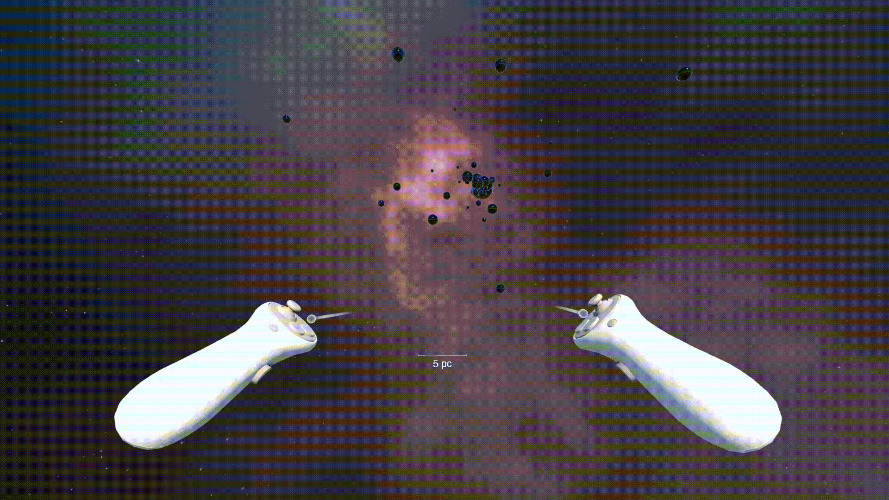
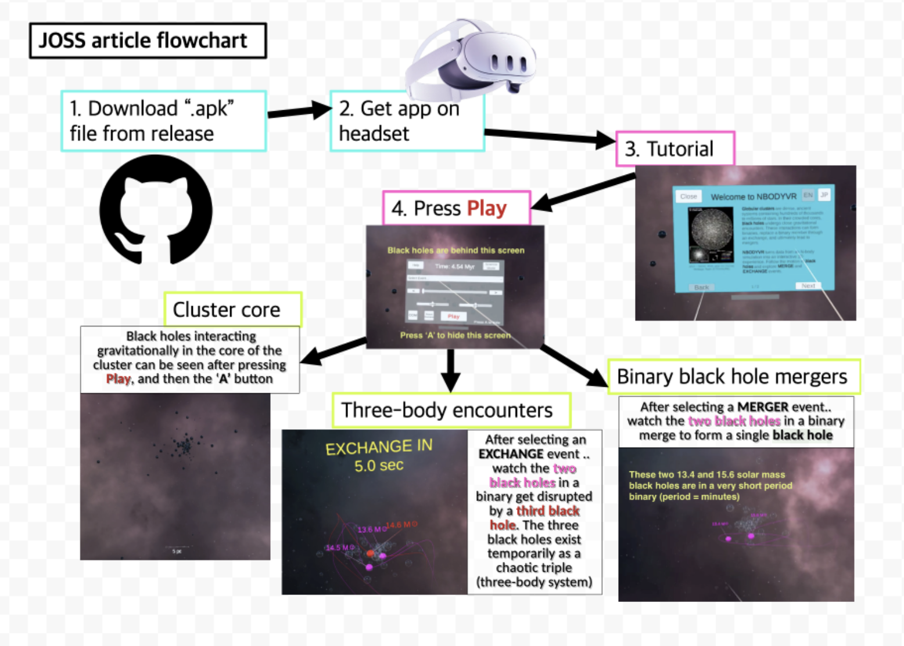
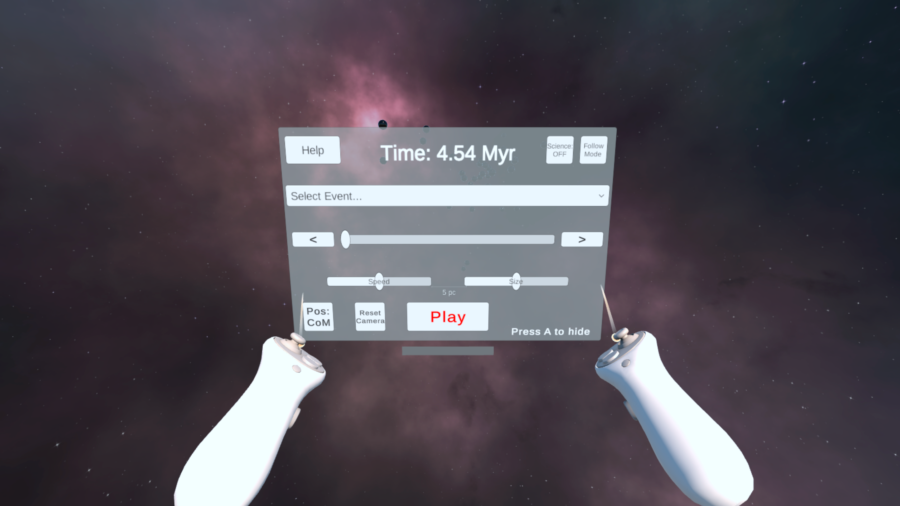

# NBody-VR Visualizer

Explore black-hole dynamics from NBODY6 simulations in virtual reality on a Meta Quest headset. Watch black-hole motion, select encounters and mergers, follow individual objects or binaries, and inspect the simulation data in Science Mode.

**The APK includes a sample dataset. You can start exploring without Unity, Python, or your own simulation files.**

<p align="center">
  
</p>

- [Try the bundled sample](#quick-play-with-the-bundled-sample)
- [Learn the controls](#basic-controls-and-exploration)
- [Use your own simulation](#use-your-own-nbody6-data)
- [Edit the Unity project](#edit-and-build-the-unity-project)
- [Understand Science Mode](#appendix-science-mode)

## What can you explore?

| View | What to try |
|---|---|
| **Black-hole population** | Play through the simulation and inspect motion and trajectories across the cluster. |
| **Three-body encounters** | Select an `EXCHANGE` event to inspect the original binary, incoming participant, and post-event configuration. `TRANSIENT EXCHANGE` records identify grouped diagnostics that return to the original pair. |
| **Binary black-hole mergers** | Select a `MERGE` event to inspect the progenitors and remnant around a merger recorded by NBODY6. |
| **Science Mode** | Compare logged event information and snapshot measurements with calculated quantities and explicitly labelled model references. |

<p align="center">
  
</p>

<p align="center"><em>Workflow overview, supplied as a draft for the JOSS article. The detailed guides below expand the installation and custom-data steps.</em></p>

Positions and velocities come from stored simulation snapshots, and event times come from NBODY6 logs. The app visualizes those outputs; it does not run a new N-body simulation. Sphere sizes and trajectory lines are display aids, and reconstructed regularized components do not resolve the internal orbit. See the [Science Mode guide](docs/science-mode.md) for interpretation and limitations. For the simulation framework, see [Aarseth (1999)](https://doi.org/10.1086/316455).

## Quick Play with the bundled sample

You need a Meta Quest headset, a computer, and a USB data cable.

1. Download the APK from [GitHub Releases](https://github.com/gkawa08/nbody-vr-visualizer-unity/releases).
2. Transfer the APK with **File Explorer** on Windows or a tool such as **ADB**, **OpenMTP**, or **SideQuest** on Mac, then install it from the headset's **Files** app.
3. Open the app from the headset's sideloaded/unknown-source applications section.
4. Choose **EN** or **JP** in the tutorial, then select **Start Exploring**.

With no external dataset installed, the app loads the bundled sample automatically. No data conversion or separate sample transfer is required. If you have previously installed your own data, see [return to the bundled sample](docs/installation.md#return-to-the-bundled-sample).

For developer-mode setup, USB authorization, installation commands, and troubleshooting, follow the [installation guide](docs/installation.md).

## Basic controls and exploration

Point the controller ray at a control and press the trigger to operate it.

<p align="center">
  
</p>

Try this short first session:

1. Press **Play** to watch the black-hole population. Press **A** to hide or reopen the main panel in the bundled scene.
2. Open **Select Event...** and choose an exchange or merger. Playback moves to a short lead-in before the event.
3. Watch the highlighted participants and their trajectories. Use the timeline or **&lt; / &gt;** to inspect stored frames.
4. Turn **Science** on to inspect the selected event's data.
5. Open **Follow Mode** to follow a black hole or an available pre- or post-event binary centre of mass.
6. Use **Exit Follow** and **Reset Camera** to return to the general view.

| Control | Purpose |
|---|---|
| **Play / Stop**, **Timeline**, **&lt; / &gt;** | Animate, seek, or step through stored frames. |
| **Select Event...** | Jump to an exchange, transient exchange, or merger. |
| **Speed** / **Size** | Adjust playback rate / the visual size of black-hole spheres. |
| **Pos: CoM / Pos: Raw** | Switch between a cluster-centred view and raw coordinates. |
| **Follow Mode** / **Exit Follow** | Follow a selected object or binary centre of mass / leave Follow Mode. |
| **Science: ON/OFF** | Show or hide the detailed event display when compatible science data are available. |
| **Reset Camera** / **Help** | Restore the initial view / reopen the tutorial. |

The original binary is highlighted in **magenta**, the interloper in **red**, the merger remnant in **cyan**, and transient-exchange participants in **orange**. Other objects are dimmed during event inspection. Labels and Science Mode provide context for these colors.

The main panel can be grabbed and repositioned. With it hidden, the right thumbstick moves the player vertically. More precise control behavior, event graphics, and color defaults are documented in the [controls reference](docs/installation.md#controls-reference).

## Use your own NBODY6 data

Keep the app installed and replace the external dataset whenever you want to explore a different run. **You do not need Unity or a new APK for each compatible dataset.**

1. Download [`nbody_bh_data.py`](nbody_bh_data.py) and install Python 3 with NumPy and h5py:

   ```bash
   python -m pip install numpy h5py
   ```

2. Prepare the supported HDF5 snapshots and matching NBODY6 output logs from the same run. Their folders may be different.
3. Start the guided converter:

   ```bash
   python nbody_bh_data.py
   ```

4. Enter the snapshot folder, event-log folder, and output dataset-folder name. Choose **Y** to create the dataset, inspect the listed input files, and confirm them with **y**. The default `.` means the directory containing the Python script.
5. Transfer the **complete generated folder** to the headset when prompted, or copy it manually using the appropriate method below. Restart the app to load it.

| Computer | Copying your dataset to the headset |
|---|---|
| **Windows** | Use File Explorer after allowing USB file access on the headset; no additional file-transfer application is normally needed. |
| **Mac** | Use an Android file-transfer tool such as [Android Debug Bridge (`adb`)](https://developer.android.com/tools/adb), [OpenMTP](https://openmtp.ganeshrvel.com/), or [SideQuest](https://sidequestvr.com/). |

The same transfer tools can copy an APK; finish its installation inside the headset's Files app, or use SideQuest or ADB to install it from the computer. The converter's automatic dataset transfer uses `adb` on either OS. If a file browser cannot access the destination folder, use the [ADB transfer instructions](docs/custom-data.md#6-transfer-the-dataset-to-quest).

The standard destination is:

```text
/sdcard/Android/data/com.kawashima.bhvisualizer/files/datasets/MyCluster/
```

Keep one active dataset folder in `datasets` to make selection unambiguous. Backups are ignored; an invalid selected dataset produces an error rather than being replaced silently with sample data.

Follow [Use your own data](docs/custom-data.md) for a complete worked example, supported input formats, transfer instructions, and conversion options. The current converter supports the documented NBODY6 output layout; arbitrary N-body file formats may require an adapter.

## Edit and build the Unity project

To change the application itself, download or clone this repository, install **Unity 6000.0.57f1** with **Android Build Support**, and open `Assets/Scenes/SampleScene.unity`.

The repository includes the Unity project and bundled fallback dataset. The APK is for running the app; the source project is for editing and rebuilding it.

See the [development guide](docs/development.md) for a clean-machine setup, the main scripts and Inspector settings, and building an APK for Quest.

## Appendix: Science Mode

Science Mode connects a selected event to its logged properties and stored PRE/POST snapshots. Depending on the event and available data, it displays participant IDs and masses, orbital parameters, binding-energy changes, cluster-frame speeds, location, reference escape speeds, and associated escape-log records.

The display identifies the origin of each kind of information:

| Label | Meaning |
|---|---|
| `[NBODY LOG]` | Values parsed from the simulation's output logs. |
| `[HDF5]` | Values read from stored snapshots. |
| `[DERIVED]` | Quantities calculated from the loaded data. |
| `[MODEL]` | Approximate reference quantities for comparison. |
| `[LOG MATCH]` | A later log record associated by object ID. |

Event time and snapshot time can differ. Model comparisons are not escape or merger decisions, and a later escape-log match does not establish causation. Unavailable measurements are left unavailable.

The [Science Mode guide](docs/science-mode.md) gives the definitions, equations, reference frames, event classification, KS/CHAIN representation, limitations, and scientific references.
