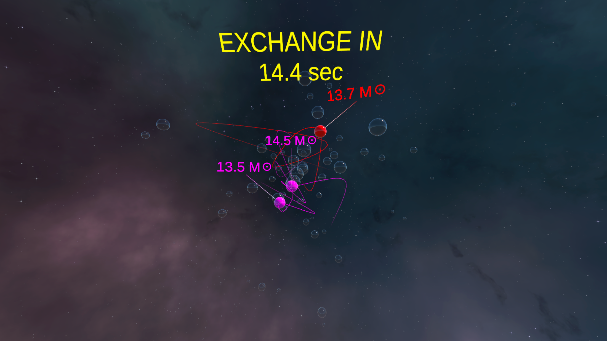
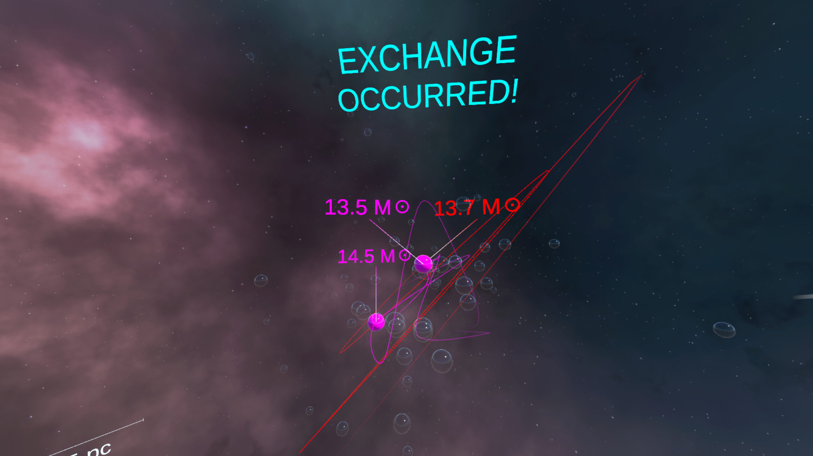
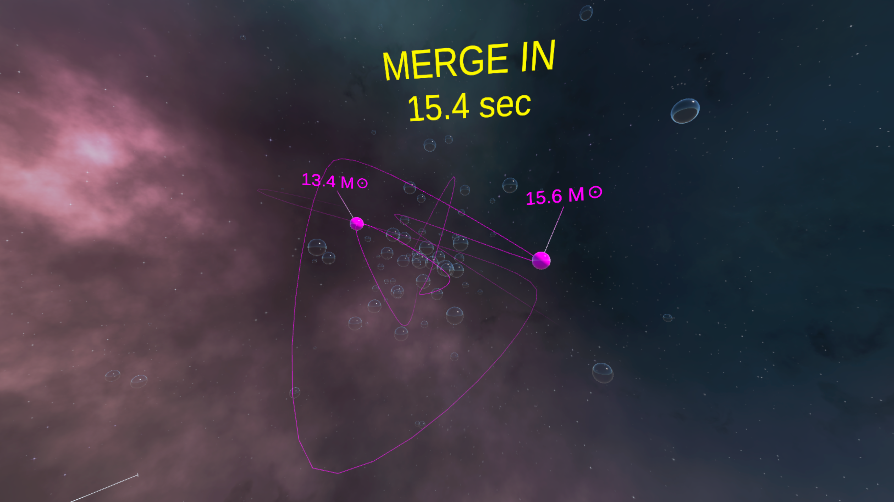
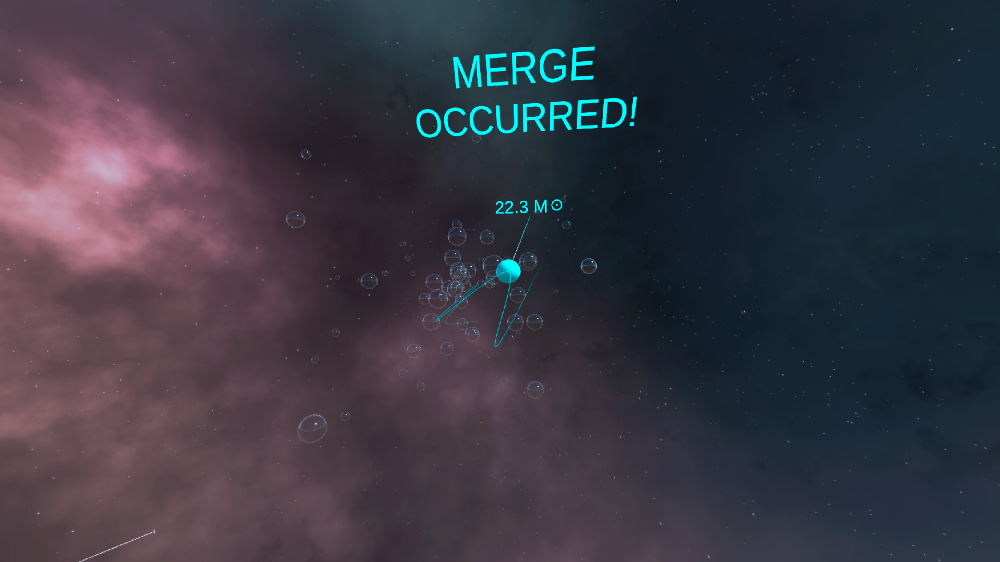

# Science Mode

[Back to the README](../README.md) · [Installation](installation.md) · [Use your own data](custom-data.md) · [Unity development](development.md)

## Event display examples

### Exchange event

<table width="100%">
  <thead>
    <tr>
      <th width="50%">Before</th>
      <th width="50%">After</th>
    </tr>
  </thead>
  <tbody>
    <tr>
      <td width="50%" align="center"></td>
      <td width="50%" align="center"></td>
    </tr>
    <tr>
      <td width="50%">The original binary members are magenta and the incoming 'interloper' is red.</td>
      <td width="50%">The post-event state is shown after the recorded exchange.</td>
    </tr>
  </tbody>
</table>

### Merge event

<table width="100%">
  <thead>
    <tr>
      <th width="50%">Before</th>
      <th width="50%">After</th>
    </tr>
  </thead>
  <tbody>
    <tr>
      <td width="50%" align="center"></td>
      <td width="50%" align="center"></td>
    </tr>
    <tr>
      <td width="50%">The two pre-merge binary members are highlighted in magenta.</td>
      <td width="50%">The merged remnant is highlighted in cyan.</td>
    </tr>
  </tbody>
</table>


## Sources of displayed values

Science Mode exposes how an event record is connected to discrete simulation snapshots. Its panel explicitly labels the origin of displayed values:

| Label | Meaning |
|---|---|
| `[NBODY LOG]` | Parsed from NBODY6 output logs. |
| `[HDF5]` | Read from a stored HDF5 snapshot. |
| `[DERIVED]` | Calculated by `nbody_bh_data.py` or, for current-frame display, by Unity from loaded data. |
| `[MODEL]` | A documented approximation used as a reference, not an NBODY6 escape decision. |
| `[LOG MATCH]` | A later log record associated by object ID; the match does not establish causation. |

## Event time, playback time, and snapshot time

The panel keeps three distinct time concepts:

- **Event time** is parsed from the NBODY6 log and converted to Myr.
- **Current playback time** is the frame currently displayed by Unity.
- **PRE/POST snapshot times** are the nearest complete HDF5 snapshots selected on either side of the event within the configured search window.

The event usually occurs between stored snapshots. PRE and POST are fixed measurements bracketing the event; they do not switch when the playback cursor crosses the event time.

## View and follow frames

| Mode | Displayed position and velocity reference |
|---|---|
| **Raw** | Original converted simulation coordinates and velocities. |
| **Cluster CoM** | The nearest cluster centre position and centre velocity are removed. |
| **Follow BH** | The view is translated relative to the selected black hole. |
| **Follow binary CoM** | The view follows the mass-weighted centre of the selected pre- or post-event pair. |

For **Cluster CoM**, Unity uses the nearest valid record from `science_cluster_dynamics.csv`. If that science record is unavailable, it falls back to the mass-weighted centre of the black holes in `bh_history.csv` for the current frame.

Changing the view frame does not recalculate the fixed event measurements stored in `science_events.csv`; those quantities use their documented cluster or triple centre-of-mass frames.

## Cluster quantities

For every converted snapshot, the script computes cluster quantities from valid positive-mass physical particles. If a positive tidal radius is available, it first restricts the calculation to particles within that radius around an initial mass-weighted centre.

The mass-weighted centre position and velocity are

```math
\boldsymbol{R}_{\mathrm{cl}}
=
\frac{\sum_i m_i\boldsymbol{r}_i}{\sum_i m_i},
\qquad
\boldsymbol{V}_{\mathrm{cl}}
=
\frac{\sum_i m_i\boldsymbol{v}_i}{\sum_i m_i}.
```

The converter then calculates a number-weighted three-dimensional RMS speed and defines the reported one-dimensional dispersion as

```math
v_{\mathrm{rms,3D}}
=
\sqrt{\frac{1}{N}\sum_i
\left|\boldsymbol{v}_i-\boldsymbol{V}_{\mathrm{cl}}\right|^2},
\qquad
\sigma_{\mathrm{1D}}=\frac{v_{\mathrm{rms,3D}}}{\sqrt{3}}.
```

These are cluster-wide quantities, not black-hole-only statistics. The reported half-mass radius is the radius of the first particle at which the cumulative mass, sorted by radius from the final centre, reaches half the included mass. General references for stellar-system kinematics and cluster dynamics are [Binney & Tremaine (2008)](https://doi.org/10.1515/9781400828722), [Spitzer (1987)](https://doi.org/10.1515/9781400858736), and [Heggie & Hut (2003)](https://doi.org/10.1017/CBO9781139164535).

For a binary with component masses $m_1$ and $m_2$, the converter uses

```math
\boldsymbol{V}_{\mathrm{bin}}
=
\frac{m_1\boldsymbol{v}_1+m_2\boldsymbol{v}_2}{m_1+m_2},
\qquad
v_{\mathrm{cl,bin}}
=
\left|\boldsymbol{V}_{\mathrm{bin}}-\boldsymbol{V}_{\mathrm{cl}}\right|.
```

The dimensionless $v/\sigma_{\mathrm{1D}}$ ratio compares the selected speed with the implemented cluster dispersion. It is not, by itself, an escape criterion.

## Exchange and transient-exchange records

For a resolved exchange represented schematically as

```math
(A+B)+C \longrightarrow (A+C)+B,
```

the converter attempts to identify:

- the PRE binary $A+B$;
- the incoming object $C$;
- the POST binary $A+C$; and
- the outgoing object $B$.

The event menu moves to a lead-in frame, highlights the original binary in magenta and the interloper in red, and displays their trajectory segments. The detailed panel shows both fixed PRE and POST measurements at once.

Several raw exchange diagnostics close in time can be grouped. If the group begins and ends with the same pair, the converter classifies it as `TRANSIENT EXCHANGE`, retains the temporary participant IDs, and does not invent net incoming or outgoing members. Exchange interactions and the statistical hardening of energetic binaries are discussed by [Heggie (1975)](https://doi.org/10.1093/mnras/173.3.729).

## Merge records

A merge event is created only from an explicit parsed NBODY6 `COAL` record. The converter looks for both logged IDs in a complete PRE snapshot and exactly one surviving ID in a complete POST snapshot. Science Mode reports the logged event time, HDF5 continuity, progenitor and remnant masses, event location, sampled cluster-frame velocity change, and any later escape-log match.

The sampled velocity difference between the selected PRE and POST snapshots is explicitly **not** interpreted as a gravitational-wave recoil kick. Likewise, a later ID-matched escape record does not establish that the merger caused the escape.

## Orbit and binding energy

When an exchange log provides semimajor axis $a$ and eccentricity $e$, the converter reports the pericentre

```math
r_{\mathrm{peri}}=a(1-e)
```

and the Newtonian two-body binding-energy magnitude

```math
|E_b|=\frac{Gm_1m_2}{2a}.
```

It compares PRE and POST values through

```math
\Delta|E_b|=|E_{b,\mathrm{post}}|-|E_{b,\mathrm{pre}}|.
```

A positive value means that the implemented binding-energy magnitude increased; a negative value means that it decreased. This sign convention corresponds to the usual hardening/softening discussion in collisional stellar dynamics; see [Heggie (1975)](https://doi.org/10.1093/mnras/173.3.729) and [Heggie & Hut (2003)](https://doi.org/10.1017/CBO9781139164535).

The logged semimajor axis is not the same quantity as the visible separation between two HDF5 coordinates. Regularized components can share a stored centre-of-mass position, so a displayed separation of zero is not sufficient evidence of physical contact or merger.

## Spherical escape-speed reference

For a target at cluster-centric radius $r$, the converter implements

```math
v_{\mathrm{esc,sph}}(r)
=
\sqrt{2G\sum_i\frac{m_i}{\max(r,r_i)}}.
```

The target object or selected target pair is excluded from the sum. This expression applies the spherical-shell potential to the included cluster particles and is used only as a cluster-self-gravity reference. It is not the complete Jacobi escape condition in an external tidal field. The underlying spherical-potential framework is covered by [Binney & Tremaine (2008)](https://doi.org/10.1515/9781400828722).

The panel reports $v/v_{\mathrm{esc,sph}}$, but a value above one is not treated as a confirmed long-term escape. Actual escape information comes from parsed `BH ESCAPE` records.

## Simple three-body recoil model

For a resolved exchange, let the post-event binary mass be $M_b=m'_1+m'_2$, the outgoing single mass be $m'_3$, and $M_{123}=M_b+m'_3$. If positive released binding energy is assigned entirely to translational kinetic energy in the final triple centre-of-mass frame, momentum and energy conservation give the implemented reference speeds

```math
v_{b,\mathrm{pred}}
=
\sqrt{\frac{2\Delta|E_b|\,m'_3}{M_bM_{123}}},
\qquad
v_{3,\mathrm{pred}}
=
\sqrt{\frac{2\Delta|E_b|\,M_b}{m'_3M_{123}}}.
```

This is a deliberately simple classical three-body estimate, not a gravitational-wave recoil model. Science Mode compares it with snapshot measurements and reports measured/predicted ratios and the measured kinetic-energy change divided by the binding-energy release. Agreement is not expected to be exact because the model omits incoming kinetic energy, the cluster potential, transient multiples, and the time offsets between the event and stored snapshots. The comparison is unavailable when the binding-energy release is not positive. Three-body scattering and binary interactions are treated in [Heggie & Hut (2003)](https://doi.org/10.1017/CBO9781139164535).

## Escape-log matching

The converter records both prompt and later escape matches:

- A prompt match searches for a compatible `BH ESCAPE` record within `100` N-body time units after an encounter. Its duration in Myr therefore depends on the run's time conversion.
- A later match searches all parsed records after the event through the end of the available logs.
- Outgoing objects are matched by ID.
- Binary escape requires the exact final pair in the same escape record.
- Merge-remnant escape is matched by the surviving/remnant ID.

An ID match reports temporal association only. It does not prove that the selected interaction caused the later escape.

## Pair markers and visible separation

With Science Mode active, the application can draw both fixed event pairs:

- magenta: PRE-event binary;
- cyan: POST-event binary.

The distance label is calculated from the displayed snapshot coordinates. It is not the logged orbital semimajor axis, and the sphere sizes are not physical horizons.

## KS/CHAIN composite particles

NBODY6 uses regularization methods to handle close subsystems; see [Aarseth (1999)](https://doi.org/10.1086/316455). In supported HDF5 layouts, `nbody_bh_data.py` treats rows `0:N` as physical particles and excludes later pseudo-particle rows from ordinary cluster statistics.

Some physical members can appear as zero-mass placeholders while a KS/CHAIN centre-of-mass row stores their combined mass. When participant relationships and masses identify the structure within the configured tolerance, the converter creates proxy component records at the composite centre-of-mass phase-space coordinates. It records how many frames were repaired in `nbody_pipeline_report.json`.

This proxy preserves event continuity for visualization; it does not reconstruct the internal regularized orbit. A composite representation is not classified as a merger. Only an explicit parsed `COAL` record creates a merger event.

## Missing measurements and limitations

Detailed values can remain unavailable when:

- a required participant is absent from all suitable PRE or POST snapshots;
- a composite particle cannot be reconstructed unambiguously;
- the log does not provide the required orbital fields;
- a net exchange cannot be resolved safely;
- a merger does not have both logged IDs before and exactly one surviving ID after the event within the search window; or
- a dataset was produced by an older converter and lacks newer science columns.

Interpret the display with these limits:

- event times come from logs, whereas positions, masses, and velocities are sampled from discrete HDF5 snapshots;
- PRE and POST measurements may be separated from the event by finite time offsets;
- the escape-speed calculation is a spherical cluster-only approximation;
- $v/v_{\mathrm{esc,sph}}>1$ is not the same as a logged or confirmed long-term escape;
- the recoil calculation is an idealized energy-and-momentum reference;
- reconstructed KS/CHAIN members share proxy centre-of-mass phase space and do not expose their internal separation; and
- world-space sphere sizes, orbit lines, and pair-line distances are visualization aids.

## Data-pipeline summary

`nbody_bh_data.py` performs the following steps:

1. Locates and validates the HDF5 snapshots and output logs.
2. Reads physical scaling from the logs or uses explicit/fallback conversions.
3. Separates physical rows from later regularization pseudo-particle rows when `N` is available.
4. Extracts black-hole histories and cluster measurements in parallel.
5. Parses exchange, coalescence, and black-hole escape records.
6. Groups related exchange diagnostics and identifies transient exchanges.
7. Conservatively reconstructs identifiable composite members.
8. Resolves complete PRE and POST event snapshots.
9. Computes event, cluster, binding-energy, escape-reference, and recoil-comparison fields.
10. Writes the four runtime CSV files, manifest, and diagnostic report.

The pipeline uses event relationships and configured tolerances; it does not contain a hard-coded special event time. Different NBODY6 variants or log formats may still require converter changes. Treat the report's warnings and unavailable fields as part of the result.

## Scientific references

- Aarseth, S. J. (1999), “From NBODY1 to NBODY6: The Growth of an Industry,” *Publications of the Astronomical Society of the Pacific*, 111, 1333–1346. [https://doi.org/10.1086/316455](https://doi.org/10.1086/316455)
- Binney, J. & Tremaine, S. (2008), *Galactic Dynamics*, 2nd ed. [https://doi.org/10.1515/9781400828722](https://doi.org/10.1515/9781400828722)
- Heggie, D. C. (1975), “Binary Evolution in Stellar Dynamics,” *Monthly Notices of the Royal Astronomical Society*, 173, 729–787. [https://doi.org/10.1093/mnras/173.3.729](https://doi.org/10.1093/mnras/173.3.729)
- Heggie, D. & Hut, P. (2003), *The Gravitational Million-Body Problem*. [https://doi.org/10.1017/CBO9781139164535](https://doi.org/10.1017/CBO9781139164535)
- Spitzer, L. (1987), *Dynamical Evolution of Globular Clusters*. [https://doi.org/10.1515/9781400858736](https://doi.org/10.1515/9781400858736)
- Wang, L. et al. (2015), “NBODY6++GPU: Ready for the Gravitational Million-Body Problem,” *Monthly Notices of the Royal Astronomical Society*, 450, 4070–4080. [https://doi.org/10.1093/mnras/stv817](https://doi.org/10.1093/mnras/stv817)
